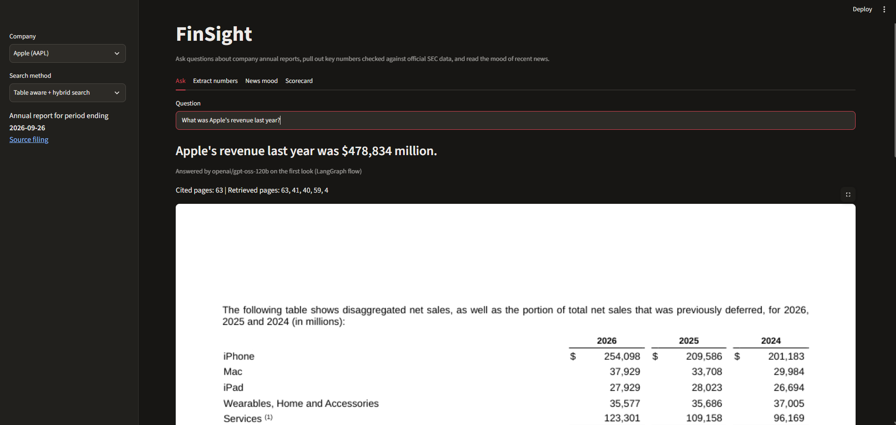

# FinSight

Ask questions about company annual reports, pull out key numbers and check them against official SEC data, and read the mood of recent news. The main point of the project is the scorecard: three ways of storing the documents for search, tested on the same questions, with correct answers taken from the official numbers each company files with the SEC (XBRL data).



## What it compares

| Method | How pages are stored for search |
|---|---|
| `plain_dense` | Page text cut into word windows, searched by meaning (the usual RAG baseline) |
| `plain_hybrid` | Same chunks, meaning search combined with keyword search (BM25) |
| `table_dense` | Plain chunks plus table rows rewritten so each number keeps its row label and year |
| `table_hybrid` | Table aware chunks with combined search |
| `visual` | Screenshots of each page searched directly with a ColPali style model, no text extraction |

Each row changes one thing from the row above it, so the scorecard shows what each change is worth.

All methods search the same PDF pages and get the same context budget (`CONTEXT_CHARS` in `config.py`) when answering, so the answer scores are a fair comparison.

## How an answer is made (LangChain + LangGraph)

The answer flow is a LangGraph graph: retrieve, build the context, answer, then check. If the model says the answer is not in its excerpts (or gives no number for a number question), the graph loops back once and answers again with twice the passages. The retriever is a LangChain `BaseRetriever` over any of the search methods above, and the answer step is a LangChain chain (prompt, Groq chat model, JSON parser). See `finsight/graph.py`. The app and the number extraction use this flow.

## How the test set is built

`python run.py questions` reads the official numbers from each filing (revenue, net income, operating income, cash, assets and so on, for every year shown in the filing) and turns them into questions with known answers. For each question it also finds the "gold pages": the PDF pages whose text contains that number as printed (for example `391,035` when the table is in millions). Retrieval is scored by whether a gold page shows up in the top 1, 3 or 5 pages. Answers count as correct when the number is within 0.5% of the official value after applying the scale the model reports. The scorecard also shows a 95% bootstrap interval, so small gaps between methods are not over read.

You can add your own free text questions in `questions_manual.csv` (see `questions_manual.example.csv`). Those are graded by a second model against your reference answer.

## Setup (Windows, conda)

Open Anaconda Prompt and run:

```
cd %USERPROFILE%\Desktop\lseg-finsight
conda create -n finsight python=3.11 -y
conda activate finsight
pip install -r requirements.txt
playwright install chromium
copy .env.example .env
```

Open `.env` and fill in `SEC_USER_AGENT` (your name and email, SEC requires it) and `GROQ_API_KEY` (free at console.groq.com/keys).

If you have an NVIDIA GPU, run the pip command for the CUDA build of PyTorch from pytorch.org inside the `finsight` environment before installing the requirements, so the visual index builds much faster.

Every time you come back to the project, run `conda activate finsight` first.

## Run

```
python run.py download          # latest annual report + official numbers for 5 companies
python run.py render            # report to PDF, page text
python run.py index             # plain and table aware indexes
python run.py questions         # automatic test set
python run.py evaluate          # retrieval scorecard, no API calls
python run.py evaluate --answers --limit 60    # also score answers (uses Groq)
python run.py evaluate --answers --limit 60 --second-look   # retry only the not found answers with more passages

pip install -r requirements-visual.txt
python run.py index --visual-only              # page image index
python run.py evaluate --answers --limit 60    # scorecard now includes the visual method

python run.py check-graph --limit 10   # confirm the LangGraph flow reproduces the evaluated results
python run.py news-eval         # honest check of the news mood model
streamlit run app.py
python -m pytest tests -q       # offline tests, no network needed
```

Answers are cached in `results/answers/`, so if the free tier rate limit stops a run, run the same command again and it carries on from where it stopped. Delete that folder when you change the prompt or model.

Results land in `results/`: `scorecard.md`, `recall5_by_metric.csv` (which kinds of numbers each method finds), and `retrieval_details.csv` (every question, every method, so you can read the failures).

## The news tab

FinBERT classifies recent Google News headlines as positive, negative or neutral. FinBERT was trained on financial news sentences, so `news-eval` tests it on a different source (finance tweets) and compares it with a small TF IDF model trained on that source, plus a majority class floor. Report whichever wins; either result is worth a sentence in an interview.

## Things worth knowing

Page numbers are PDF page numbers of the rendered report, not the page numbers printed in the filing.

Groq retires models now and then. If a call fails with a model error, pick a current one from console.groq.com/docs/models and set `LLM_MODEL` in `.env`.

The visual model defaults to `vidore/colSmol-256M`, which runs on a CPU (slowly). On a GPU, set `VISUAL_MODEL=vidore/colqwen2.5-v0.2` for a stronger model.

## Putting it online

Create a Streamlit Space on Hugging Face, push this folder plus `data/` (remove `data/` from `.gitignore` in that copy), and add `GROQ_API_KEY` as a Space secret. Skip the visual index if the free CPU Space is too slow for it.

## Results (first run)

Five companies (Apple, Microsoft, NVIDIA, Coca-Cola, Nike), 774 pages, 147 automatic questions, 143 of them with gold pages.

| Method | Page recall at 1 | Page recall at 5 | 95% interval at 5 |
|---|---|---|---|
| plain_dense | 0.748 | 0.916 | 0.87 to 0.96 |
| plain_hybrid | 0.650 | 0.937 | 0.90 to 0.97 |
| table_dense | 0.720 | 0.895 | 0.85 to 0.94 |
| table_hybrid | 0.678 | 0.916 | 0.87 to 0.96 |

Answer accuracy with `openai/gpt-oss-120b` on 60 sampled questions (same questions for every row):

| Method | Correct | Accuracy | 95% interval |
|---|---|---|---|
| plain_dense | 52 | 0.867 | 0.77 to 0.95 |
| table_hybrid | 51 | 0.850 | 0.75 to 0.93 |
| plain_dense + second look | 54 | 0.900 | 0.82 to 0.97 |
| table_hybrid + second look | 54 | 0.900 | 0.82 to 0.97 |

"Second look" asks again with twice the passages, only for questions where the first answer said the information was not in its excerpts, so it adds calls only for those misses.

What this shows: finding a page that contains the number is already about 92% solved by the baseline, and the four setups sit inside each other's intervals, so table aware chunking did not change retrieval here. Nearly every wrong answer was the model saying the answer was not in the pages it was given, not a wrong number or wrong year, so the next gains are in retrieval, not in table reading. Giving the model a second, wider look at the report on those misses lifted accuracy from 87% to 90% for both methods; the intervals still overlap, so a larger test set is needed to call it a firm gain.

The LangGraph flow was checked against these cached results with `python run.py check-graph --limit 10`: it matched on 10 of 10 questions, including the ones that needed a second look.
